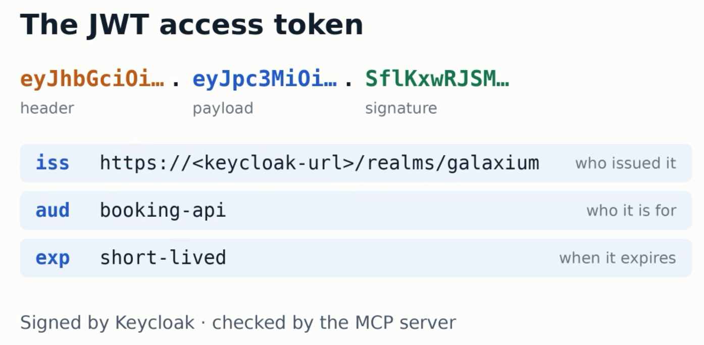
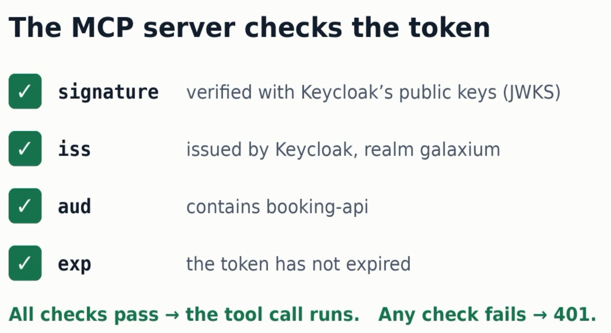

# 2. Verify The OAuth2 MCP Server

Use this guide after the deployment in [1-galaxium_setup.md](./1-galaxium_setup.md).
It talks directly to Keycloak and the MCP server on IBM Code Engine, without any browser UI.

The fast path is one script:

```sh
bash infrastructure/verify_code_engine_oauth2.sh
```

The sections below run the same checks by hand, so you see what watsonx Orchestrate will do later.

## 2.1 Load The Endpoints

```sh
set -a; source infrastructure/galaxium-endpoints.env; set +a
echo "${GALAXIUM_MCP_URL}"
```

Code Engine scales the applications to zero. The first request after a pause can take
several seconds while the container starts.

## 2.2 Unauthenticated Access Fails

```sh
curl -i -X POST "${GALAXIUM_MCP_URL}" \
  -H 'Content-Type: application/json' \
  -H 'Accept: application/json, text/event-stream' \
  -H 'MCP-Protocol-Version: 2025-11-25' \
  -d '{"jsonrpc":"2.0","id":1,"method":"initialize","params":{}}'
```

Expected: `HTTP 401` with a `WWW-Authenticate: Bearer` header.

## 2.3 No Implicit Flow In The Metadata

```sh
curl -fsS "${GALAXIUM_MCP_BASE_URL}/.well-known/oauth-authorization-server" \
  | jq '{response_types_supported, grant_types_supported}'
```

Expected: `grant_types_supported` contains `client_credentials` and does **not** contain `implicit`.
The watsonx Orchestrate [connections overview](https://developer.watson-orchestrate.ibm.com/connections/overview) lists *OAuth (Implicit)* as not supported for Remote MCP Toolkits, and the infrastructure repository disables the implicit flow for security reasons. This check reads the MCP server's metadata only. It does not test watsonx Orchestrate.

## 2.4 Request A `client_credentials` Token

Example base on the [deploy.env.oauth2.template](https://github.com/thomassuedbroecker/galaxium-travels-infrastructure-tsuedbro/blob/main/deployment/ibm-code-engine/deploy.env.oauth2.template) example in the [infrastructure repository](https://github.com/thomassuedbroecker/galaxium-travels-infrastructure-tsuedbro/tree/main/deployment/ibm-code-engine).

```sh
GALAXIUM_OIDC_CLIENT_ID=web-app-proxy
GALAXIUM_OIDC_CLIENT_SECRET=web-app-proxy-secret
```

```sh
ACCESS_TOKEN="$(curl -fsS -X POST "${GALAXIUM_TOKEN_URL}" \
  -u "${GALAXIUM_OIDC_CLIENT_ID}:${GALAXIUM_OIDC_CLIENT_SECRET}" \
  -d grant_type=client_credentials | jq -r .access_token)"
echo "${ACCESS_TOKEN}" | cut -d. -f2 | tr '_-' '/+' | base64 -d 2>/dev/null | jq '{iss, aud, exp}'
```

Expected: `iss` equals `${GALAXIUM_KEYCLOAK_URL}/realms/galaxium` and `aud` contains `booking-api`.

This token exchange authenticates with the `web-app-proxy` client (`GALAXIUM_OIDC_CLIENT_ID`) via Keycloak's `clients` authentication flow and requests access for the `booking-api` audience (see [Keycloak Realm and Authentication Configuration in Guide 1](./1-galaxium_setup.md#16-keycloak-realm-and-authentication-configuration)).



When the MCP server receives an authenticated request, it verifies the token's signature via JWKS and checks the claims (`iss`, `aud`, `exp`):



## 2.5 `initialize`

```sh
curl -i -X POST "${GALAXIUM_MCP_URL}" \
  -H 'Content-Type: application/json' \
  -H 'Accept: application/json, text/event-stream' \
  -H 'MCP-Protocol-Version: 2025-11-25' \
  -H "Authorization: Bearer ${ACCESS_TOKEN}" \
  -d '{"jsonrpc":"2.0","id":1,"method":"initialize","params":{"protocolVersion":"2025-11-25","capabilities":{},"clientInfo":{"name":"manual-check","version":"1.0.0"}}}'
```

Expected: `HTTP 200` and an `mcp-session-id` response header. Copy it:

```sh
export SESSION_ID='<paste-the-mcp-session-id-here>'
```

## 2.6 `tools/list` And `tools/call`

```sh
curl -sS -X POST "${GALAXIUM_MCP_URL}" \
  -H 'Content-Type: application/json' \
  -H 'Accept: application/json, text/event-stream' \
  -H 'MCP-Protocol-Version: 2025-11-25' \
  -H "MCP-Session-Id: ${SESSION_ID}" \
  -H "Authorization: Bearer ${ACCESS_TOKEN}" \
  -d '{"jsonrpc":"2.0","id":2,"method":"tools/list","params":{}}'
```

Expected tools: `list_flights`, `book_flight`, `get_bookings`, `cancel_booking`, `register_user`, `get_user_id`.

```sh
curl -sS -X POST "${GALAXIUM_MCP_URL}" \
  -H 'Content-Type: application/json' \
  -H 'Accept: application/json, text/event-stream' \
  -H 'MCP-Protocol-Version: 2025-11-25' \
  -H "MCP-Session-Id: ${SESSION_ID}" \
  -H "Authorization: Bearer ${ACCESS_TOKEN}" \
  -d '{"jsonrpc":"2.0","id":3,"method":"tools/call","params":{"name":"list_flights","arguments":{}}}'
```

Expected: `HTTP 200` and the list of flights.

## 2.7 Common Problems

| Symptom | Cause | Fix |
|---|---|---|
| `401` without a token | Expected | Send `Authorization: Bearer <token>` |
| `401` with a token | Token expired, or issuer mismatch | Request a new token from `GALAXIUM_TOKEN_URL` |
| Token request returns `401` | Client secret differs from the Keycloak realm | Re-run the deployment so the realm is imported with the generated secret |
| Timeout on the first call | MCP server scaled to zero (cold start) | Retry after a few seconds |
| `initialize` works, `tools/list` fails | Wrong session | Reuse the exact `mcp-session-id` from `initialize` |
| Any other server-side error | See what the MCP server logged | `bash infrastructure/inspect_code_engine.sh log-follow galaxium-booking-mcp` (needs `kubectl`, see [infrastructure/README.md](./infrastructure/README.md)) |

## [Home](./README.md)
