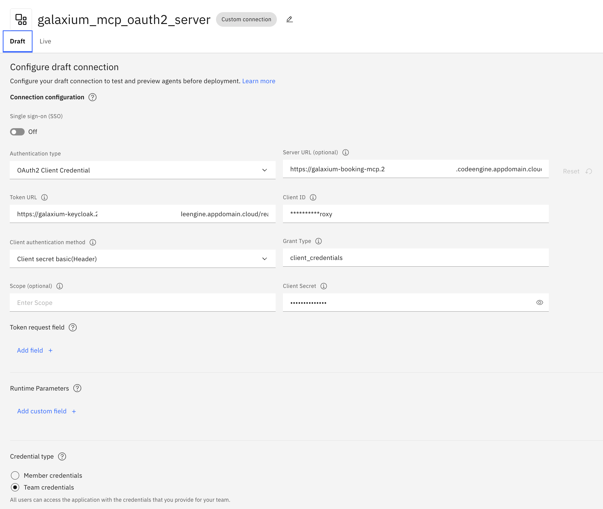

# 4. Add The OAuth2 MCP Server To `watsonx Orchestrate`

This guide registers the Galaxium MCP server on IBM Code Engine in your **remote**
watsonx Orchestrate instance with the OAuth 2.0 `client_credentials` flow, and imports a
booking example agent.

Use it after [1-galaxium_setup.md](./1-galaxium_setup.md) (either Path A — deploy from scratch,
or Path B — already deployed via §1.9) and
[3-watsonx-orchestrate-adk-setup.md](./3-watsonx-orchestrate-adk-setup.md).

Both paths produce the same `infrastructure/galaxium-endpoints.env` file. This guide reads
only that file — no other input differs between the two paths.

## How OAuth2 Works In This Setup

```text
watsonx Orchestrate (SaaS)
        │ 1. POST <Keycloak>/realms/galaxium/protocol/openid-connect/token
        │    grant_type=client_credentials, client_id, client_secret
        ▼
   Keycloak on Code Engine
        │ 2. JWT access token  (iss = Keycloak URL, aud = booking-api)
        ▼
watsonx Orchestrate (SaaS)
        │ 3. POST <MCP>/mcp   Authorization: Bearer <token>
        ▼
Galaxium MCP server on Code Engine (AUTH_MODE=oauth2)
        │ 4. validates signature (JWKS), iss, aud, exp
        ▼
   tools/list, tools/call results
```

Because both systems are public HTTPS endpoints, watsonx Orchestrate reaches Keycloak and
the MCP server directly. No LAN IP, VM networking or issuer rewriting is needed. Keycloak validates the client credentials against the `web-app-proxy` client (`GALAXIUM_OIDC_CLIENT_ID`) via the `clients` authentication flow, issuing a JWT access token targeted for `booking-api` (see [Keycloak Realm and Authentication Configuration](./1-galaxium_setup.md#16-keycloak-realm-and-authentication-configuration)).

> **Why is `--client-id` set to `web-app-proxy`?**
> The upstream infrastructure repository provides `web-app-proxy` out-of-the-box with `client_credentials` grant enabled and a configured secret. To avoid manual realm edits in Keycloak, watsonx Orchestrate reuses this client in the demo. In production, you would create a dedicated client such as `watsonx-orchestrate`.

### Token Structure and Verification

The JWT access token issued by Keycloak contains the required `iss`, `aud`, and `exp` claims:


When watsonx Orchestrate sends requests to the MCP server with the bearer token, the MCP server validates the signature against Keycloak's JWKS and verifies the claims:


| Setting | Value |
|---|---|
| Connection `--kind` | `oauth_auth_client_credentials_flow` (*OAuth (Implicit)* is **not supported for Remote MCP Toolkits**, see the [connections overview](https://developer.watson-orchestrate.ibm.com/connections/overview)) |
| Connection `--type` | `team` |
| Environments | `draft` and `live` (both configured) |
| Toolkit `--transport` | `streamable_http` |

## 4.1 Run The Automation Script

```sh
bash watsonx-orchestrate-adk/wxo_add_oauth2_mcp_server.sh
```

The script reads `infrastructure/galaxium-endpoints.env` and `watsonx-orchestrate-adk/.env`.
The manual commands it runs are explained below.

Every step prints `>> <step> (waits up to <n>s)`, a `... still running` line every 10 seconds, and
`OK <step> (<n>s)` when it is done. After 60 seconds without a result it prints `NO RESPONSE for 60s`
with the message that it is still working. A step that exceeds its limit is stopped and reported as
`TIMEOUT` together with the retry information, so the script never hangs silently. The slowest step is
the toolkit import (up to 240 s), because it calls `tools/list` on the MCP server.
This progress output comes from the shared helper [`bash-lib/step_progress.sh`](./bash-lib/step_progress.sh), which all
automation scripts use (infrastructure, verification, ADK).

## 4.2 Manual Steps

Prepare the shell:

```sh
source watsonx-orchestrate-adk/.venv/bin/activate
set -a
source watsonx-orchestrate-adk/.env
source infrastructure/galaxium-endpoints.env
set +a
orchestrate env remove --name galaxium-remote   # ignore the error if it does not exist yet; answer y if asked
orchestrate env add --name galaxium-remote --url "${WXO_URL}"
orchestrate env activate galaxium-remote --api-key "${WXO_API_KEY}"
export APP_ID="galaxium_mcp_oauth2_server"
```

#### Create The Connection

```sh
orchestrate connections remove --app-id ${APP_ID}
orchestrate connections add --app-id ${APP_ID}
```

#### Configure And Set The Credentials

Two different URLs are used:

| Variable | Value | Purpose |
|---|---|---|
| `GALAXIUM_MCP_BASE_URL` | `https://<mcp-app>...codeengine.appdomain.cloud` | Connection `--url`, server root without path |
| `GALAXIUM_MCP_URL` | `${GALAXIUM_MCP_BASE_URL}/mcp` | Toolkit import `--url`, full MCP endpoint |

```sh
for ENVIRONMENT in draft live; do
  orchestrate connections configure \
    --app-id ${APP_ID} --env ${ENVIRONMENT} \
    --kind oauth_auth_client_credentials_flow --type team \
    --url ${GALAXIUM_MCP_BASE_URL}

  orchestrate connections set-credentials \
    --app-id ${APP_ID} --env ${ENVIRONMENT} \
    --client-id ${GALAXIUM_OIDC_CLIENT_ID} \
    --client-secret ${GALAXIUM_OIDC_CLIENT_SECRET} \
    --token-url ${GALAXIUM_TOKEN_URL}
done
```

In the watsonx Orchestrate web UI (or after running the automation script), the resulting connection configuration for the `draft` and `live` environments maps directly to these parameters:



#### Import The MCP Toolkit

```sh
orchestrate toolkits remove --name galaxium_travels_booking_mcp_oauth2
orchestrate toolkits add \
  --kind mcp \
  --name galaxium_travels_booking_mcp_oauth2 \
  --description "Galaxium Travels Booking MCP imported through OAuth2 client credentials." \
  --transport streamable_http \
  --tools "list_flights,book_flight,get_bookings,cancel_booking,register_user,get_user_id" \
  --url ${GALAXIUM_MCP_URL} \
  --app-id ${APP_ID}
```

> The import calls `tools/list` on the live server. Run guide
> [2](./2-galaxium_oauth2_mcp_verification.md) first if you are unsure the
> stack is healthy. The script wakes up the Code Engine applications before the import.

## 4.3 Import The Example Agent

The agent [`agent_galaxium_booking_oauth2_test.yaml`](./watsonx-orchestrate-adk/agents/agent_galaxium_booking_oauth2_test.yaml)
uses the six MCP tools, referenced as `toolkit_name:tool_name`.

```sh
bash watsonx-orchestrate-adk/wxo_import_agent.sh
```

Check that `llm: groq/openai/gpt-oss-120b` is in the model list the script prints.
If your instance offers another model, change `llm` in the YAML and re-run the script.

## 4.4 Test In watsonx Orchestrate

Open the watsonx Orchestrate web UI → **Chat** → select **Galaxium Booking OAuth2 Test Agent** and ask:

```text
Which flights are available?
```

The agent calls `list_flights` through the OAuth2 connection. The chat tests the **draft**
version. Release it with `orchestrate agents deploy --name galaxium_booking_oauth2_test_agent` when you are happy.

## 4.5 Clean Up

Remove the agent, the MCP toolkit and the connection from the remote watsonx Orchestrate instance:

```sh
bash watsonx-orchestrate-adk/wxo_cleanup.sh          # asks for confirmation
bash watsonx-orchestrate-adk/wxo_cleanup.sh --yes    # no confirmation
```

Only the three Galaxium resources are removed. Your remote access configuration
(`watsonx-orchestrate-adk/.env` and the `galaxium-remote` CLI environment) and the Code Engine deployment are kept.

## 4.6 Common Problems

| Symptom | Cause | Fix |
|---|---|---|
| Import fails with an authentication error | Wrong client secret or token URL | Re-run `infrastructure/path-a-deploy/deploy_code_engine_oauth2.sh endpoints` (Path A) or `infrastructure/path-b-existing/import_existing_deployment.sh` (Path B), then this script |
| Import fails with a timeout | Cold start of the MCP server (Code Engine) | Re-run the script |
| `Invalid issuer` / `Invalid audience` in the MCP logs | Keycloak URL changed after the deployment | Re-deploy (`infrastructure/path-a-deploy/deploy_code_engine_oauth2.sh`, or ask the deployer on Path B) so issuer and audience are re-derived |
| Agent import fails on `llm` | Model not available | Pick a model from `orchestrate models list` |
| Agent answers without calling a tool | Tool names not found | Check `orchestrate tools list`; names must be `galaxium_travels_booking_mcp_oauth2:<tool>` |
| `set-credentials` rejects `--token-url` | Older ADK | Install `ibm-watsonx-orchestrate` `2.18.2` or later |
| Unclear why the MCP server rejects a call | Server-side details are only in the Code Engine logs | `bash infrastructure/inspect_code_engine.sh log-follow galaxium-booking-mcp` |

References:

- <https://developer.watson-orchestrate.ibm.com/connections/overview>
- <https://developer.watson-orchestrate.ibm.com/tools/toolkits/remote_mcp_toolkits>

## [Home](./README.md)
