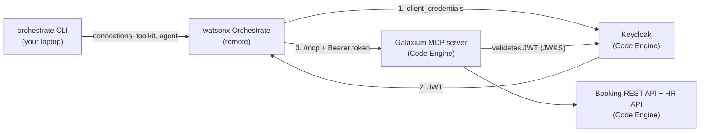

# Galaxium Travels: OAuth2 MCP On IBM Code Engine With watsonx Orchestrate

A minimal, step-by-step guide. The Galaxium Travels OAuth2 MCP server runs on **IBM Code Engine**
and is used by an example agent in a **remote watsonx Orchestrate** instance.

Scope:

- Infrastructure on **IBM Code Engine** only — no local containers
- **OAuth2** (Keycloak, `client_credentials`) — no Basic Auth
- **Remote watsonx Orchestrate** only — the ADK is installed, the Developer Edition is **not** used
- One example agent
- Minimal initial configuration: **3 values** (see below)

Trial: [watsonx Orchestrate](https://www.ibm.com/docs/en/watsonx/watson-orchestrate/base?topic=orchestrate-accessing-watsonx-trial-version)

## Architecture



## What You Need To Configure

| # | Value | File |
|---|---|---|
| 1 | `IBM_CLOUD_API_KEY` (Path A only) | `infrastructure/.env` |
| 2 | `WXO_API_KEY` | `watsonx-orchestrate-adk/.env` |
| 3 | `WXO_URL` (service instance URL) | `watsonx-orchestrate-adk/.env` |

All other secrets (Keycloak admin password, OAuth2 client secret, Flask secret) are generated by the deployment script.

## Two Paths For The Infrastructure

| | Path A — deploy from scratch | Path B — existing deployment from another repository |
|---|---|---|
| Infrastructure repo cloned into `infrastructure/` | Yes | **No** |
| You provide | `IBM_CLOUD_API_KEY` | `deploy.env.oauth2` + `deployment-links.env` from the deployer |
| Script | `deploy_code_engine_oauth2.sh` | `import_existing_deployment.sh` |
| First step | Clone the infrastructure repo at `v6.2.3` ([Guide 1.2](./1-galaxium_setup.md)) | Copy the deployer's files, do not clone |
| Details | [Guide 1.1 – 1.7](./1-galaxium_setup.md) | [Guide 1.8](./1-galaxium_setup.md) |

Both paths write `infrastructure/galaxium-endpoints.env`. Everything after that is identical. See [infrastructure/README.md](./infrastructure/README.md).

## Quick Start

```sh
cp watsonx-orchestrate-adk/.env_template watsonx-orchestrate-adk/.env   # set WXO_API_KEY, WXO_URL

# Path A: deploy from scratch
(cd infrastructure \
  && git clone https://github.com/thomassuedbroecker/galaxium-travels-infrastructure-tsuedbro.git \
  && cd galaxium-travels-infrastructure-tsuedbro && git checkout v6.2.3)  # first step: clone the infrastructure repo
cp infrastructure/.env_template infrastructure/.env                      # set IBM_CLOUD_API_KEY
bash infrastructure/path-a-deploy/deploy_code_engine_oauth2.sh

# Path B: existing deployment, infrastructure repo not cloned
bash infrastructure/path-b-existing/import_existing_deployment.sh \
  --links <path>/deployment-links.env --deploy-env infrastructure/deploy.env.oauth2

# Both paths
bash infrastructure/verify_code_engine_oauth2.sh
bash watsonx-orchestrate-adk/wxo_install_adk.sh
bash watsonx-orchestrate-adk/wxo_add_oauth2_mcp_server.sh
bash watsonx-orchestrate-adk/wxo_import_agent.sh

# Inspect pods / logs at any time
bash infrastructure/inspect_code_engine.sh                              # pods, deployments, configmaps
bash infrastructure/inspect_code_engine.sh log-follow galaxium-booking-mcp  # live log
bash infrastructure/inspect_code_engine.sh log        galaxium-booking-mcp  # saved log
```

Then chat with **Galaxium Booking OAuth2 Test Agent** in the watsonx Orchestrate web UI and ask: *Which flights are available?*

## Guide Flow

| # | Guide | What you do |
|---|---|---|
| 1 | [Set Up The Infrastructure On Code Engine](./1-galaxium_setup.md) | Deploy Keycloak, MCP server, APIs with one script |
| 2 | [Verify The OAuth2 MCP Server](./2-galaxium_oauth2_mcp_verification.md) | Token, `initialize`, `tools/list` against Code Engine |
| 3 | [Set Up The watsonx Orchestrate ADK](./3-watsonx-orchestrate-adk-setup.md) | Install the CLI, connect to the remote instance |
| 4 | [Add The OAuth2 MCP Server](./4-watsonx-orchestrate-adk-add-oauth2-mcp.md) | Connection, toolkit and example agent |

## Repository Layout

```text
├── 1-galaxium_setup.md
├── 2-galaxium_oauth2_mcp_verification.md
├── 3-watsonx-orchestrate-adk-setup.md
├── 4-watsonx-orchestrate-adk-add-oauth2-mcp.md
├── .gitignore                                ← keep secrets out of Git
├── bash-lib/step_progress.sh                 ← shared bash step progress helper (steps, 60 s status, timeout, retry info)
├── infrastructure/
│   ├── .env_template                     ← both paths: shared settings
│   ├── README.md
│   ├── verify_code_engine_oauth2.sh      ← both paths: verify the MCP server
│   ├── inspect_code_engine.sh            ← kubectl inspection: pods, deployments, logs
│   ├── path-a-deploy/
│   │   └── deploy_code_engine_oauth2.sh      ← clone, generate secrets, deploy, write endpoints
│   └── path-b-existing/                  ← infrastructure repo NOT cloned
│       ├── import_existing_deployment.sh     ← endpoints file for an already deployed stack
│       └── deployment-links.env_template
└── watsonx-orchestrate-adk/
    ├── .env_template
    ├── wxo_install_adk.sh                ← create .venv, install the ADK
    ├── wxo_env.sh                        ← shared: activate the remote environment
    ├── wxo_add_oauth2_mcp_server.sh      ← connection + toolkit (guide 4)
    ├── wxo_import_agent.sh               ← import the example agent
    ├── wxo_cleanup.sh                    ← remove agent, toolkit, connection
    └── agents/agent_galaxium_booking_oauth2_test.yaml
```

## Cost Estimate

> **IBM Cloud requires a Pay-as-you-Go account** for both Code Engine and watsonx Orchestrate paid plans.
> Costs start as soon as applications are running. Tear down the stack when you are done.

### Free Trial Options

There are **free options** available for both services. You must verify eligibility yourself — IBM does not guarantee availability, and terms change without notice.

| Option | Who can use it | How to access | Notes |
|---|---|---|---|
| **watsonx Orchestrate trial** | Anyone with an IBM Cloud account | [Trial sign-up page](https://www.ibm.com/docs/en/watsonx/watson-orchestrate/base?topic=orchestrate-accessing-watsonx-trial-version) | Time-limited; sufficient to follow this guide |
| **IBM Cloud free tier (Code Engine)** | Anyone with an IBM Cloud Lite or Pay-as-you-Go account | Automatically applied; see [Code Engine pricing](https://cloud.ibm.com/catalog/services/codeengine) | Monthly free allowance for vCPU-seconds, GB-seconds and HTTP calls |
| **IBM TechZone** | **IBM employees and IBM Business Partners only** | <https://techzone.ibm.com> | Provides pre-provisioned environments including watsonx Orchestrate and IBM Cloud accounts for demos and PoCs. Access requires an IBM w3id (employees) or an IBMid linked to a valid Business Partner organisation. **Verify your eligibility before relying on TechZone for this guide.** |

> **Important — verify before you start:**
> Trial availability, free-tier quotas and TechZone access policies change over time.
> Always check the current terms on the respective product pages before beginning.
> IBM is not responsible for access being available when you follow this guide.

### IBM Code Engine

Code Engine bills per actual consumption — you are **not** charged when an application scales to zero (no traffic).
Charges apply for vCPU-seconds, GB-seconds and incoming HTTP requests.

| What triggers a charge | When it happens |
|---|---|
| **Source build** (Path A only) | Once per deploy — image is built from source. Billed for vCPU + memory for the duration of the build (typically a few minutes per service). |
| **Running applications** | Billed only while at least one instance is running (vCPU-hours × GB-hours). The stack scales to zero between requests. |
| **Incoming HTTP calls** | Each request to the Keycloak, MCP server or booking API endpoint. Internal traffic within the project is free. |

The Galaxium stack deploys five applications (Keycloak, MCP server, Booking API, HR API, two web UIs).
The **default instance size is 1 vCPU / 4 GB**. At that size, one application running for one hour costs 1 vCPU-hour + 4 GB-hours.

- **One-time deployment cost (Path A):** several minutes of build time per application (five applications).
- **Idle cost:** near zero — Code Engine scales all applications to zero when there is no traffic.
- **Active testing:** a short interactive session (tens of minutes) is a small fraction of one vCPU-hour per application.

For current per-unit rates and a cost estimator, see <https://cloud.ibm.com/catalog/services/codeengine>.
Code Engine also includes a **monthly free allowance** — check the pricing page for the current amounts.

### watsonx Orchestrate

watsonx Orchestrate is a SaaS product on IBM Cloud. Charges depend on the plan you choose.

| Plan | Notes |
|---|---|
| **Trial** | Free, time-limited. Enough to follow this guide. See the [trial page](https://www.ibm.com/docs/en/watsonx/watson-orchestrate/base?topic=orchestrate-accessing-watsonx-trial-version). |
| **Pay-as-you-Go** | Billed per usage. No minimum commitment. |
| **Subscription / Enterprise** | Fixed monthly fee; contact IBM sales. |

This guide only uses the **ADK (CLI)** to register a connection, a toolkit and one agent.
It does **not** deploy a new watsonx Orchestrate instance — you connect to an existing one.
No additional instance charges are created by following the guide steps.

For current plan details and pricing, see <https://www.ibm.com/products/watsonx-orchestrate/pricing>.

### Minimising Cost During The Demo

1. Run the teardown script as soon as you are done with the Code Engine stack.
2. Do not set `--min-scale` above `0` on any application (the default). This ensures scale-to-zero when idle.
3. If you only want to verify watsonx Orchestrate (guides 3 and 4) and the stack is already deployed by someone else, use **Path B** — no deployment cost on your account.

## Security Notes

- The Code Engine endpoints are **public**. Generated secrets protect them; do not reuse demo secrets.
- `.env`, `galaxium-endpoints.env` and `deploy.env.oauth2` contain secrets. They are git-ignored (`.gitignore`).
- Delete the demo when you are done: see teardown in [infrastructure/README.md](./infrastructure/README.md). Code Engine costs apply while it runs.

## Dependencies

| Component | Version | License |
|---|---|---|
| `ibm-watsonx-orchestrate` | `2.18.2` | MIT |
| Galaxium infrastructure repository | `v6.2.3` | Apache-2.0 |
| Keycloak (`quay.io/keycloak/keycloak`) | `26.0` | Apache-2.0 |
| CLI tools | `ibmcloud` + code-engine plugin, `git`, `curl`, `jq`, `python3`, `kubectl` | Installed by you, not redistributed. See [THIRD_PARTY_NOTICES.md](./THIRD_PARTY_NOTICES.md) |

## Useful References

- watsonx Orchestrate ADK: <https://developer.watson-orchestrate.ibm.com/>
- Remote MCP toolkits: <https://developer.watson-orchestrate.ibm.com/tools/toolkits/remote_mcp_toolkits>
- Connections: <https://developer.watson-orchestrate.ibm.com/connections/overview>
- Infrastructure repository: <https://github.com/thomassuedbroecker/galaxium-travels-infrastructure-tsuedbro>
