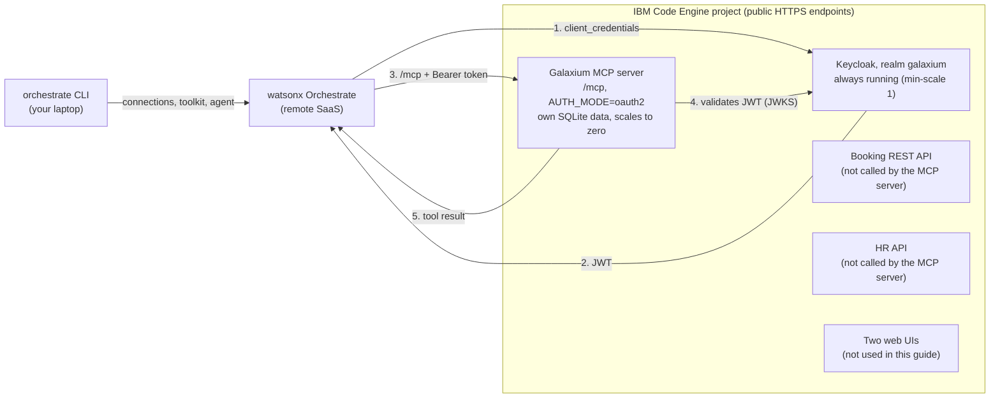

# Galaxium Travels: OAuth2 MCP On IBM Code Engine With watsonx Orchestrate

A minimal, step-by-step guide. The Galaxium Travels OAuth2 MCP server runs on **IBM Code Engine**
and is used by an example agent in a **remote watsonx Orchestrate** instance.

Scope:

- Infrastructure on **IBM Code Engine** only — no local containers
- **OAuth2** (Keycloak, `client_credentials`) — no Basic Auth
- **Remote watsonx Orchestrate** only — the ADK is installed, the Developer Edition is **not** used
- One example agent
- Minimal initial configuration: **3 values** (see below)

Trial: [watsonx Orchestrate](https://www.ibm.com/docs/en/watsonx/watson-orchestrate/base?topic=orchestrate-accessing-watsonx-trial-version)

## What You Get

After the four guides you have:

1. A secured MCP server (6 booking tools) running on IBM Code Engine, protected by OAuth2 tokens from Keycloak.
2. A watsonx Orchestrate **connection** that fetches those tokens automatically.
3. A watsonx Orchestrate **toolkit** that imports the MCP tools, and an **agent** that uses them.

The slowest part is the Code Engine build and Keycloak import on Path A (several minutes).

The six MCP tools (see [`agent_galaxium_booking_oauth2_test.yaml`](./watsonx-orchestrate-adk/agents/agent_galaxium_booking_oauth2_test.yaml)):

| Tool | Purpose |
|---|---|
| `list_flights` | List available flights |
| `book_flight` | Book a flight (`user_id`, `name`, `flight_id`) |
| `get_bookings` | Show bookings |
| `cancel_booking` | Cancel a booking |
| `register_user` | Create a user |
| `get_user_id` | Look up a user ID by name and email |

## Key Concepts

| Term | Meaning in this repository |
|---|---|
| **MCP** (Model Context Protocol) | Open protocol that lets an AI agent discover (`tools/list`) and call (`tools/call`) tools on a server over HTTP. Here: the Galaxium booking tools. |
| **OAuth2 `client_credentials`** | Machine-to-machine login. A client ID and secret are exchanged for a short-lived JWT at Keycloak. No user and no browser involved. |
| **Keycloak** | The identity provider that issues and signs the JWT. The MCP server validates signature (JWKS), `iss`, `aud` and `exp`. |
| **IBM Code Engine** | Serverless container platform that runs Keycloak, the MCP server and the APIs. Keycloak always keeps one instance running. The other apps scale to zero when idle, so the first call to them can be slow (cold start). |
| **ADK** | The watsonx Orchestrate Agent Development Kit. Provides the `orchestrate` CLI used to configure the remote instance from your laptop. |
| **Connection** (`app-id`) | Stores the token URL, client ID and secret in watsonx Orchestrate. Referenced by the toolkit. |
| **Toolkit** | The imported set of MCP tools. Tools are addressed as `<toolkit_name>:<tool_name>`. |
| **Agent** | An LLM plus instructions plus tools. Defined in [`agent_galaxium_booking_oauth2_test.yaml`](./watsonx-orchestrate-adk/agents/agent_galaxium_booking_oauth2_test.yaml). |

Resource names used by the scripts:

| Resource | Name |
|---|---|
| CLI environment | `galaxium-remote` |
| Connection `app-id` | `galaxium_mcp_oauth2_server` |
| Toolkit | `galaxium_travels_booking_mcp_oauth2` |
| Agent | `galaxium_booking_oauth2_test_agent` (display name *Galaxium Booking OAuth2 Test Agent*) |

## Architecture

Container view. The numbers 1–5 show the order of a tool call. The decisions behind it are in [Why These Choices](#why-these-choices-mini-adr).



| Container | Runs on | Role in this guide |
|---|---|---|
| orchestrate CLI (ADK) | Your laptop | Creates the connection, toolkit and agent in the remote instance |
| watsonx Orchestrate | IBM Cloud (SaaS) | Runs the agent, fetches the token, calls the MCP server |
| Keycloak | Code Engine, **always running** (`min-scale 1`) | Issues and signs the JWT (`client_credentials`). The only component that must stay up, because the MCP server validates tokens against it. |
| Galaxium MCP server | Code Engine, scales to zero | Exposes the 6 tools, validates the JWT. Serves the tools from its **own SQLite database** (`booking_system_mcp/db.py` upstream). |
| Booking REST API, HR API | Code Engine, scale to zero | Deployed by the infrastructure repository. **Not called by the MCP server** and not used in this guide. |
| Two web UIs | Code Engine, scale to zero | Deployed by the infrastructure repository, not used here |

The MCP tool data is stored in the MCP server's own SQLite file (checked in the upstream repository at `v6.2.4`), so bookings are not shared with the Booking REST API and are lost when the MCP container restarts.

## Why These Choices (Mini ADR)

**Status:** Accepted for this guide.

**Context:** watsonx Orchestrate is a remote SaaS service. It must call an MCP server over the internet, and the server must only accept authorised callers. The call is made by an agent, not by a person in a browser.

| Decision | Reason | Alternatives (not used here) |
|---|---|---|
| OAuth2 `client_credentials` | Machine-to-machine, no user or browser. Two independent reasons rule out the implicit flow: (1) the watsonx Orchestrate [connections overview](https://developer.watson-orchestrate.ibm.com/connections/overview) marks *OAuth (Implicit)* as **not supported for Remote MCP Toolkits** (partial for Python and OpenAPI tools), while *Client Credentials* is supported; (2) the infrastructure repository disables it for security (RFC 9700), see its `docs/mcp_access_options.md`. [Guide 2.3](./2-galaxium_oauth2_mcp_verification.md) checks that the MCP server does not advertise `implicit`. It does not test watsonx Orchestrate. | Implicit flow (not supported for remote MCP toolkits, disabled upstream), Basic Auth (out of scope for this guide) |
| IBM Code Engine | Every application gets a public HTTPS URL, so watsonx Orchestrate reaches Keycloak and the MCP server directly. The token `iss` matches the real Keycloak URL, so no LAN IP or issuer rewriting is needed. Builds run from source, so no local container runtime. Apart from Keycloak, applications scale to zero when idle. | Local containers and the Developer Edition (out of scope) |
| Keycloak | It is the identity provider shipped with the infrastructure repository (`v6.2.4`), so the realm and client are created by the deployment. It is kept at `min-scale 1` so tokens can always be issued and keys fetched. | Other identity providers were not evaluated in this repository |

**Consequences:**

- (+) Few settings: 3 values to configure, the other secrets are generated.
- (+) The MCP server, APIs and web UIs cost nothing while idle.
- (−) Keycloak runs all the time, so the stack has a continuous cost until you tear it down (see [Cost Estimate](#cost-estimate)).
- (−) The endpoints are public. Protection relies on the generated secrets (see [Security Notes](#security-notes)).
- (−) Cold starts: the first request to an idle MCP server can take several seconds.
- (−) Keycloak is started in `start-dev` mode with the realm imported at start. Without `KEYCLOAK_DATA_STORE_NAME` its data is lost when the container restarts. Treat this as a demo setup.
- (−) The connection is of type `team` with `client_credentials`: every caller acts as the same client, with no per-user identity. The watsonx Orchestrate connections overview lists Auth Code and Password as supported for remote MCP toolkits too, so a per-user (`member`) setup is a possible later change. It is not covered by this guide.
- (−) If the Keycloak URL changes, issuer and audience must be re-derived by redeploying.

## What You Need To Configure

| # | Value | File |
|---|---|---|
| 1 | `IBM_CLOUD_API_KEY` (Path A; on Path B only for `--code-engine` and `inspect_code_engine.sh`) | `infrastructure/.env` |
| 2 | `WXO_API_KEY` | `watsonx-orchestrate-adk/.env` |
| 3 | `WXO_URL` (service instance URL) | `watsonx-orchestrate-adk/.env` |

All other secrets (Keycloak admin password, OAuth2 client secret, Flask secret) are generated by the deployment script.

## Two Paths For The Infrastructure

> "Path A" and "Path B" are names **in this repository**: A = deploy, B = import an existing deployment.
> They are unrelated to the "Path B" in the upstream infrastructure repository's `DEPLOY-PATH-B-OAUTH2.md`,
> which is the name of its OAuth2 Code Engine variant (and is what Path A deploys).

| | Path A — deploy from scratch | Path B — existing deployment from another repository |
|---|---|---|
| Infrastructure repo cloned into `infrastructure/` | Yes | **No** |
| You provide | `IBM_CLOUD_API_KEY` | `deploy.env.oauth2` + `deployment-links.env` from the deployer (save both in `infrastructure/`) |
| `IBM_CLOUD_API_KEY` needed? | Yes | Only with `--code-engine` or `inspect_code_engine.sh` |
| Script | `deploy_code_engine_oauth2.sh` | `import_existing_deployment.sh` |
| First step | Clone the infrastructure repo at `v6.2.4` ([Guide 1.2](./1-galaxium_setup.md)) | Copy the deployer's files, do not clone |
| Details | [Guide 1.1 – 1.7](./1-galaxium_setup.md) | [Guide 1.8](./1-galaxium_setup.md) |

Both paths write `infrastructure/galaxium-endpoints.env`. Everything after that is identical. See [infrastructure/README.md](./infrastructure/README.md).

## Quick Start

```sh
cp watsonx-orchestrate-adk/.env_template watsonx-orchestrate-adk/.env   # set WXO_API_KEY, WXO_URL

# Path A: deploy from scratch
(cd infrastructure \
  && git clone https://github.com/thomassuedbroecker/galaxium-travels-infrastructure-tsuedbro.git \
  && cd galaxium-travels-infrastructure-tsuedbro && git checkout v6.2.4)  # first step: clone the infrastructure repo
cp infrastructure/.env_template infrastructure/.env                      # set IBM_CLOUD_API_KEY
bash infrastructure/path-a-deploy/deploy_code_engine_oauth2.sh

# Path B: existing deployment, infrastructure repo not cloned
bash infrastructure/path-b-existing/import_existing_deployment.sh \
  --links infrastructure/deployment-links.env --deploy-env infrastructure/deploy.env.oauth2

# Both paths
bash infrastructure/verify_code_engine_oauth2.sh
bash watsonx-orchestrate-adk/wxo_install_adk.sh
bash watsonx-orchestrate-adk/wxo_add_oauth2_mcp_server.sh
bash watsonx-orchestrate-adk/wxo_import_agent.sh

# Inspect pods / logs at any time
bash infrastructure/inspect_code_engine.sh                              # pods, deployments, configmaps
bash infrastructure/inspect_code_engine.sh log-follow galaxium-booking-mcp  # live log
bash infrastructure/inspect_code_engine.sh log        galaxium-booking-mcp  # saved log
```

Then chat with **Galaxium Booking OAuth2 Test Agent** in the watsonx Orchestrate web UI and ask: *Which flights are available?*

## Guide Flow

| # | Guide | What you do |
|---|---|---|
| 1 | [Set Up The Infrastructure On Code Engine](./1-galaxium_setup.md) | Deploy Keycloak, MCP server, APIs with one script (Path A) **or** import an existing deployment (Path B) |
| 2 | [Verify The OAuth2 MCP Server](./2-galaxium_oauth2_mcp_verification.md) | Token, `initialize`, `tools/list` against Code Engine |
| 3 | [Set Up The watsonx Orchestrate ADK](./3-watsonx-orchestrate-adk-setup.md) | Install the CLI, connect to the remote instance |
| 4 | [Add The OAuth2 MCP Server](./4-watsonx-orchestrate-adk-add-oauth2-mcp.md) | Connection, toolkit and example agent |

## Repository Layout

```text
├── 1-galaxium_setup.md
├── 2-galaxium_oauth2_mcp_verification.md
├── 3-watsonx-orchestrate-adk-setup.md
├── 4-watsonx-orchestrate-adk-add-oauth2-mcp.md
├── .gitignore                                ← keep secrets out of Git
├── LICENSE, THIRD_PARTY_NOTICES.md
├── bash-lib/step_progress.sh                 ← shared bash step progress helper (steps, 60 s status, timeout, retry info)
├── infrastructure/
│   ├── .env_template                     ← both paths: shared settings
│   ├── README.md
│   ├── galaxium-endpoints.env            ← generated by Path A or B, input of all later steps (git-ignored)
│   ├── deploy.env.oauth2                 ← generated (A) or copied (B), contains secrets (git-ignored)
│   ├── logs/                             ← saved pod logs (git-ignored)
│   ├── verify_code_engine_oauth2.sh      ← both paths: verify the MCP server
│   ├── inspect_code_engine.sh            ← kubectl inspection: pods, deployments, logs
│   ├── path-a-deploy/
│   │   └── deploy_code_engine_oauth2.sh      ← clone, generate secrets, deploy, write endpoints
│   └── path-b-existing/                  ← infrastructure repo NOT cloned
│       ├── import_existing_deployment.sh     ← endpoints file for an already deployed stack
│       └── deployment-links.env_template
└── watsonx-orchestrate-adk/
    ├── .env_template
    ├── wxo_install_adk.sh                ← create .venv, install the ADK
    ├── wxo_env.sh                        ← shared: activate the remote environment
    ├── wxo_add_oauth2_mcp_server.sh      ← connection + toolkit (guide 4)
    ├── wxo_import_agent.sh               ← import the example agent
    ├── wxo_cleanup.sh                    ← remove agent, toolkit, connection
    └── agents/agent_galaxium_booking_oauth2_test.yaml
```

## Cost Estimate

> **IBM Cloud requires a Pay-as-you-Go account** for both Code Engine and watsonx Orchestrate paid plans.
> Costs start as soon as applications are running. Tear down the stack when you are done.

### Free Trial Options

There are **free options** available for both services. You must verify eligibility yourself — IBM does not guarantee availability, and terms change without notice.

| Option | Who can use it | How to access | Notes |
|---|---|---|---|
| **watsonx Orchestrate trial** | Anyone with an IBM Cloud account | [Trial sign-up page](https://www.ibm.com/docs/en/watsonx/watson-orchestrate/base?topic=orchestrate-accessing-watsonx-trial-version) | Time-limited; sufficient to follow this guide |
| **IBM Cloud free tier (Code Engine)** | Anyone with an IBM Cloud Lite or Pay-as-you-Go account | Automatically applied; see [Code Engine pricing](https://cloud.ibm.com/catalog/services/codeengine) | Monthly free allowance for vCPU-seconds, GB-seconds and HTTP calls |
| **IBM TechZone** | **IBM employees and IBM Business Partners only** | <https://techzone.ibm.com> | Provides pre-provisioned environments including watsonx Orchestrate and IBM Cloud accounts for demos and PoCs. Access requires an IBM w3id (employees) or an IBMid linked to a valid Business Partner organisation. **Verify your eligibility before relying on TechZone for this guide.** |

> **Important — verify before you start:**
> Trial availability, free-tier quotas and TechZone access policies change over time.
> Always check the current terms on the respective product pages before beginning.
> IBM is not responsible for access being available when you follow this guide.

### IBM Code Engine

Code Engine bills per actual consumption: vCPU-seconds, GB-seconds and incoming HTTP requests.
An application that has scaled to zero is not charged. **Keycloak never scales to zero** (see below).

| What triggers a charge | When it happens |
|---|---|
| **Source build** (Path A only) | Once per deploy — image is built from source. Billed for vCPU + memory for the duration of the build (typically a few minutes per service). |
| **Keycloak (always running)** | Continuously, as long as the stack is deployed. The upstream defaults are `KEYCLOAK_MIN_SCALE=1` and `KEYCLOAK_MAX_SCALE=1`. |
| **Other applications** | Billed only while at least one instance is running. They scale to zero between requests (`SERVICE_MIN_SCALE=0`, `WEB_MIN_SCALE=0`). |
| **Incoming HTTP calls** | Each request to the Keycloak, MCP server or booking API endpoint. Internal traffic within the project is free. |

The Galaxium stack deploys several applications (Keycloak, MCP server, Booking API, HR API and two web UIs).
Default sizes in the upstream `deploy.env.oauth2.template` (`v6.2.4`): Keycloak 1 vCPU / 2 GB, services 1 vCPU / 1 GB, web UIs 1 vCPU / 1 GB.

- **One-time deployment cost (Path A):** several minutes of build time per application.
- **Idle cost:** **not zero.** Keycloak (1 vCPU / 2 GB) keeps running. Only the MCP server, the APIs and the web UIs drop to zero.
- **Active testing:** a short interactive session adds a small amount of vCPU/GB time for the MCP server on top of the Keycloak baseline.

For current per-unit rates and a cost estimator, see <https://cloud.ibm.com/catalog/services/codeengine>.
Code Engine also includes a **monthly free allowance** — check the pricing page for the current amounts.

### watsonx Orchestrate

watsonx Orchestrate is a SaaS product on IBM Cloud. Charges depend on the plan you choose.

| Plan | Notes |
|---|---|
| **Trial** | Free, time-limited. Enough to follow this guide. See the [trial page](https://www.ibm.com/docs/en/watsonx/watson-orchestrate/base?topic=orchestrate-accessing-watsonx-trial-version). |
| **Pay-as-you-Go** | Billed per usage. No minimum commitment. |
| **Subscription / Enterprise** | Fixed monthly fee; contact IBM sales. |

This guide only uses the **ADK (CLI)** to register a connection, a toolkit and one agent.
It does **not** deploy a new watsonx Orchestrate instance — you connect to an existing one.
No additional instance charges are created by following the guide steps.

For current plan details and pricing, see <https://www.ibm.com/products/watsonx-orchestrate/pricing>.

### Minimising Cost During The Demo

1. Run the teardown script ([Guide 1.6](./1-galaxium_setup.md)) as soon as you are done with the Code Engine stack. Clean the watsonx Orchestrate side with `wxo_cleanup.sh` ([Guide 4.5](./4-watsonx-orchestrate-adk-add-oauth2-mcp.md)).
2. Keep the upstream scaling defaults. Keycloak stays at `min-scale 1` by design (the MCP server needs it), so the only way to stop its cost is the teardown. Do not raise `SERVICE_MIN_SCALE` or `WEB_MIN_SCALE` above `0`.
3. If you only want to verify watsonx Orchestrate (guides 3 and 4) and the stack is already deployed by someone else, use **Path B** — no deployment cost on your account.

## Security Notes

- The Code Engine endpoints are **public**. Generated secrets protect them; do not reuse demo secrets.
- `.env`, `galaxium-endpoints.env` and `deploy.env.oauth2` contain secrets. They are git-ignored (`.gitignore`).
- Delete the demo when you are done: see teardown in [infrastructure/README.md](./infrastructure/README.md). Code Engine costs apply while it runs.

## Dependencies

| Component | Version | License |
|---|---|---|
| `ibm-watsonx-orchestrate` | `2.18.2` | MIT |
| Galaxium infrastructure repository | `v6.2.4` | Apache-2.0 |
| Keycloak (`quay.io/keycloak/keycloak`) | `26.0` | Apache-2.0 |
| CLI tools | `ibmcloud` + code-engine plugin, `git`, `curl`, `jq`, `python3`, `kubectl` | Installed by you, not redistributed. See [THIRD_PARTY_NOTICES.md](./THIRD_PARTY_NOTICES.md) |

## License

This repository is licensed under the MIT License, see [LICENSE](./LICENSE). Third-party components keep their own licenses, see [THIRD_PARTY_NOTICES.md](./THIRD_PARTY_NOTICES.md).

## Useful References

- watsonx Orchestrate ADK: <https://developer.watson-orchestrate.ibm.com/>
- Remote MCP toolkits: <https://developer.watson-orchestrate.ibm.com/tools/toolkits/remote_mcp_toolkits>
- Connections: <https://developer.watson-orchestrate.ibm.com/connections/overview>
- Infrastructure repository: <https://github.com/thomassuedbroecker/galaxium-travels-infrastructure-tsuedbro>
